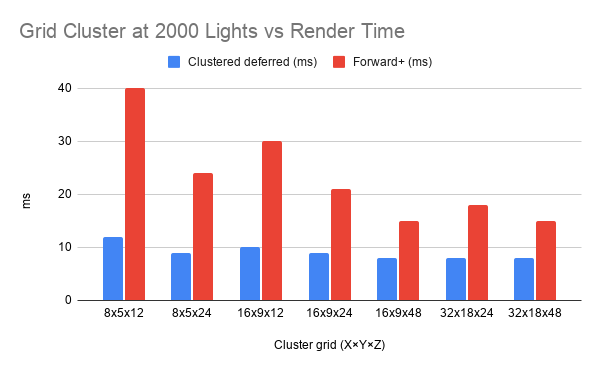

WebGPU Forward+ and Clustered Deferred Shading
======================

**University of Pennsylvania, CIS 565: GPU Programming and Architecture, Project 4**

* Yanfu Ou
* Tested on: **Google Chrome Version 155.0.8059.39** on
  Ubuntu 24.04LTS, Ryzen 7 7840 @ 2.5GHz 64GB DDR4, RTX 5070 8GB Laptop

## Project Description

This project implements three real-time renderers in WebGPU and compares how they scale with the number of dynamic point lights in the Sponza atrium scene:

- **Naive forward rendering**: every fragment loops over every light in the scene. This is the baseline.
- **Forward+**: a compute shader divides the view into a 3D grid of clusters (screen-space tiles × exponential depth slices) and assigns each light to the clusters its sphere of influence overlaps. During shading, each fragment looks up its cluster and evaluates only the lights stored there.
- **Clustered Deferred**: uses the same light clustering as Forward+, but first renders albedo, normal, and world position into a G-buffer. A fullscreen pass then lights each visible pixel once using its cluster's light list, so lighting cost no longer depends on overdraw.

Lights move every frame, so the clustering compute pass runs each frame before shading. The render mode and light count can be changed at runtime from the GUI. The performance analysis below measures frame time across light counts and cluster grid dimensions.

## Live Demo

See the renderings live by clicking on the image above or [here](https://www.yanfuou.com/Project4-WebGPU-Forward-Plus-and-Clustered-Deferred-Yanfu/).  
## Demo GIF

#### Naive

#### Forward Plus

#### Cluster Deferred

For 30+ second video demos, please visit this Google Drive folder <em>[link](https://drive.google.com/drive/folders/1NInLw6EY4m12Z0vE3MrYnOCdxM8Wtqde?usp=sharing)</em>. 

## Performance Analysis

#### Number of Lights vs Render Time of Different Methods

Times are the one-second MS average. This sweep was measured with the original 16 × 9 × 24 cluster grid, before the grid optimization described below.

| Number of Lights   | Clustered Deferred(ms) | Forward(ms) | naive(ms) |
| :---- | :-------------------- | :------ | :-------- |
| 50    | 6                     | 6       | 7         |
| 100   | 6                     | 6       | 13        |
| 200   | 6                     | 6       | 24        |
| 300   | 6                     | 6       | 35        |
| 400   | 6                     | 6       | 53        |
| 500   | 6                     | 7       | 57        |
| 600   | 6                     | 8       | 73        |
| 700   | 6                     | 9       | 80        |
| 800   | 6                     | 10      | 91        |
| 900   | 6                     | 11      | 104       |
| 1000  | 6                     | 11      | 113       |
| 1300  | 6                     | 12      | 147       |
| 1600  | 7                     | 16      | 179       |
| 1900  | 8                     | 17      | 213       |
| 2100  | 9                     | 25      | 238       |
| 2500  | 9                     | 24      | 283       |
| 3000  | 12                    | 30      | 335       |
| 3500  | 12                    | 31      | 392       |
| 4000  | 12                    | 34      | 447       |
| 4500  | 14                    | 40      | 504       |
| 5000  | 14                    | 47      | 560       |

#### Grid Cluster at 2000 Lights vs Render Time

Cluster count at 2000 lights. Times are the one-second MS average. 

| X | Y | Z | Total clusters | Clustered deferred (ms) | Forward+ (ms) |
| ---: | ---: | ---: | ---: | ---: | ---: |
| 8 | 5 | 12 | 480 | 12 | 40 |
| 8 | 5 | 24 | 960 | 9 | 24 |
| 16 | 9 | 12 | 1728 | 10 | 30 |
| 16 | 9 | 24 | 3456 | 9 | 21 |
| 16 | 9 | 48 | 6912 | 8 | 15 |
| 32 | 18 | 24 | 13824 | 8 | 18 |
| 32 | 18 | 48 | 27648 | 8 | 15 |

Times are the one-second average of frame time, in ms. The MS counter rounds to a whole millisecond. A frame that finishes inside one refresh is reported as 6 ms, so identical 6 ms cells mean both methods were fast enough to hold the refresh rate, not that their GPU cost was equal.

#### Optimization: Finer Cluster Grid

Based on the grid sweep above, I changed the cluster grid in `src/shaders/shaders.ts` from 16 × 9 × 24 to 32 × 18 × 48 (`numClustersX`, `numClustersY`, `numClustersZ`). Measured at 2000 lights:

| Renderer | Before: 16 × 9 × 24 (ms) | After: 32 × 18 × 48 (ms) | Change |
| :---- | ---: | ---: | ---: |
| Forward+ | 21 | 15 | −6 ms (≈29% faster) |
| Clustered Deferred | 9 | 8 | −1 ms (≈11% faster) |

Smaller clusters hold fewer lights, so each fragment (Forward+) or pixel (deferred) walks a shorter light list. Forward+ gains more because it repeats that walk for every overdrawn fragment, while deferred runs it once per pixel. The clustering compute pass does 8× more cluster-versus-light tests, but at 2000 lights that extra work is smaller than the shading it saves.

The cost is memory. Each cluster stores up to 511 light indices (2080 bytes with padding), so the cluster buffer grows from about 6.9 MiB (3456 clusters) to about 55 MiB (27648 clusters). `16 × 9 × 48` reached the same 15 ms for Forward+ with a quarter of the clusters (about 13.7 MiB), so it would be the better choice if memory is tight.

### Forward+

For each frame, a compute shader builds an axis-aligned box for every screen tile and exponential depth slice. Afterwards, it then tests every light against that box. A fragment looks up its cluster from its screen position and view-space depth and shades only the lights stored there. The naive renderer does the same shading, but the loop bound is `lightSet.numLights`, so every fragment evaluates every light.

That is why the naive column is almost linear. As seen from the regression line on the Number of Lights vs Render Time graph, it adds about 0.11 ms per added light. For example, 13 ms at 100 lights and 560 ms at 5000. However, Forward+ increases above the 6 ms floor at around 500 lights and reaches 47 ms at 5000(with the original grid). At that point it is about 12× faster than naive because a fragment only walks the lights that overlap its cluster. The light radius is 2, so most lights miss most clusters.

Forward+ still grows with the light count because each overlapping fragment repeats that walk. Sponza has a lot of depth complexity, and this pass shades every fragment that passes the depth test. Clustering itself also walks every light once per cluster, so a finer grid is not free.

The grid sweep at 2000 lights separates those two costs. Splitting depth helps more than splitting the screen: `16×9×12` (1728 clusters) takes 30 ms, while `8×5×24` (960 clusters) takes 24 ms. The worst grid is the coarsest, `8×5×12` at 40 ms, where each cluster holds many lights. The best measured grids are `16×9×48` and `32×18×48`, both 15 ms. Going from 6912 to 27648 clusters did not get slower, so on this GPU the clustering pass is still cheaper than the extra shading it removes. The original setting, `16×9×24`, was 21 ms at 2000 lights, which is why the shipped grid is now `32×18×48`. A 1 ms reversal, such as 25 ms at 2100 lights and 24 ms at 2500, is the one-second average moving, not a real speedup.

Forward+ is at its best with few overlapping lights and little overdraw, and at its worst with many lights and heavy overdraw. Further gains would come from a depth prepass so only the visible fragment is shaded, and from tightening the cluster test so large overlaps do not fill the 511-light cap.

### Cluster Deferred

This reuses the same cluster buffer. The geometry pass writes albedo, normal, and world position into a G-buffer and does no lighting. A fullscreen pass then loads those values and runs the same per-cluster light loop as Forward+. Each pixel is lit once, regardless of how many triangles overlap it.

The G-buffer is the tradeoff. Albedo is `rgba8unorm`. Normal and position are `rgba16float`. That is extra bandwidth on every pixel, which Forward+ does not pay. In return, lighting no longer scales with overdraw. Deferred stays on the 6 ms floor until 1600 lights, then rises slowly to 14 ms at 5000 lights. At 5000 lights it is about 3× faster than Forward+ (47 ms) and about 40× faster than naive (560 ms).

The same grid sweep shows the same shape, compressed into a smaller range of 12 ms on `8×5×12`, and 8 ms on the three finest grids. Deferred is less sensitive to cluster size because the light loop runs once per pixel instead of once per shaded fragment. Below about 1600 lights, the 6 ms floor hides its advantage over Forward+. Deferred is at its best with many small lights in an overlapping scene, and at its worst at low light counts, where it still pays for the G-buffer.

However, storing a full world position and a `vec4` normal is more G-buffer data than the lighting pass needs. Reconstructing position from depth, and packing the normal into fewer bits would cut that bandwidth. The geometry pass would still be the cost that remains when the light count is low.

### Comparison and Evaluation

Clustered deferred is the fastest of all three rendering methods, and its advantages are the most obvious once there are enough lights for either method to miss a refresh. From 50 to about 400 lights, both Forward+ and Clustered Deferred sit at 6 ms. From 500 lights up, Cluster Deferred pulls away, and the gap widens as the light count grows.

Clustered Deferred is the better fit for this scene because there are many small lights and heavy overdraw. Forward+ is the better fit when the light count is modest or when the view has little overlap, as it skips the G-buffer write and still only shades the lights in each cluster. 

The practical tradeoff is overdraw against bandwidth. Forward+ shades with the interpolated vertex data, so overlapping surfaces pay the full light loop again, but it keeps one geometry pass and no extra color targets. Deferred pays for three extra render targets on every pixel, then lights each visible pixel once. With a light radius of 2, the cluster lists stay small enough that the deferred lighting pass stays cheap. The Forward+ pass pays those same lists once per fragment, which is what pushes it to 47 ms at 5000 lights.

### Credits

- [Vite](https://vitejs.dev/)
- [loaders.gl](https://loaders.gl/)
- [dat.GUI](https://github.com/dataarts/dat.gui)
- [stats.js](https://github.com/mrdoob/stats.js)
- [wgpu-matrix](https://github.com/greggman/wgpu-matrix)
