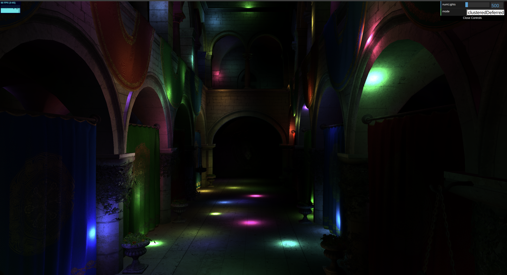
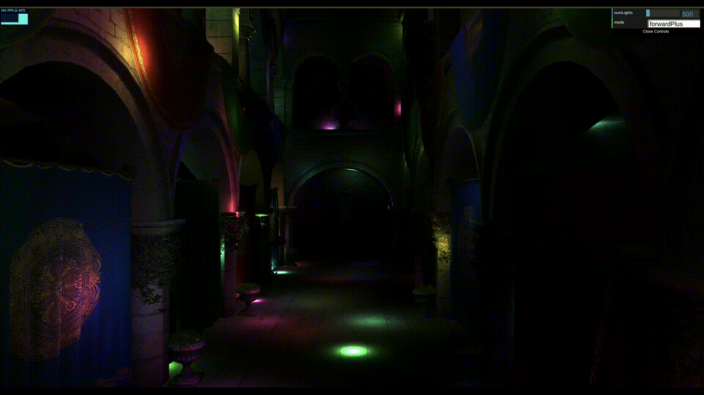
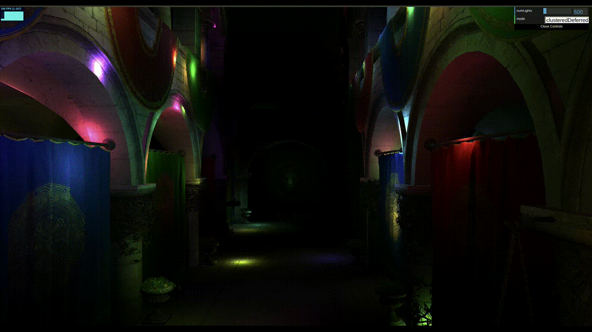

WebGL Forward+ and Clustered Deferred Shading
======================

**University of Pennsylvania, CIS 565: GPU Programming and Architecture, Project 4**

* Yanfu Ou
* Tested on: **Google Chrome Version 155.0.8059.39 ** on
  Ubuntu 24.04LTS, Ryzen 7 7840 @ 2.5GHz 64GB DDR4, RTX 5070 8GB

## Live Demo

See the renderings live by clicking on the image above or [here](https://www.yanfuou.com/Project4-WebGPU-Forward-Plus-and-Clustered-Deferred-Yanfu/).  
## Demo GIF

#### Native

#### Forward Plus

#### Cluster Deferred

## Performance Analysis

### Credits

- [Vite](https://vitejs.dev/)
- [loaders.gl](https://loaders.gl/)
- [dat.GUI](https://github.com/dataarts/dat.gui)
- [stats.js](https://github.com/mrdoob/stats.js)
- [wgpu-matrix](https://github.com/greggman/wgpu-matrix)
